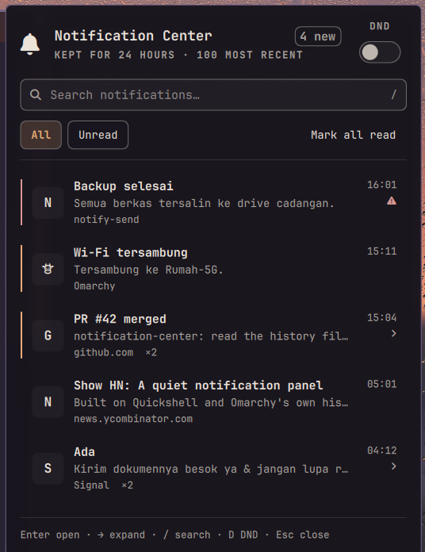

# Notification Center

A bar panel for Omarchy's own notification history. The bell shows what
arrived while you were away, grouped the way Omarchy groups it: one stack per
app, one per site for browsers, and standalone cards for one-off Omarchy
actions.

Notification Center is a **viewer**. Omarchy's notification service stays the
only daemon; this plugin reads its history and never writes to it.



## Features

- **Grouped history** — apps stack; browser notifications split by domain.
- **Unread marks** — a badge and per-row dots since you last looked.
- **Search** — every word must match the app, site, title, or body.
- **Unread filter** — only what arrived since you last acknowledged.
- **Do Not Disturb** — reads and writes Omarchy's own DND state.
- **Keyboard-first** — the same cursor, Enter, and Esc contract as Omarchy's
  own panels.
- **Theme-native** — colors, fonts, spacing, borders, and motion come from the
  running Omarchy theme.
- **English and Indonesian** — follows Setup → Language; other languages fall
  back to English.
- **Read-only** — no deletion of notification history, no execution of stored
  `execArgv`.

## Requirements

- Omarchy 4.5 or newer.

## Install

```sh
omarchy plugin add https://github.com/wicky14/notification-center.git --enable
```

Or manually:

```sh
git clone https://github.com/wicky14/notification-center.git \
  ~/.config/omarchy/plugins/wicky14.notification-center
omarchy plugin enable wicky14.notification-center right
```

Move it later with the standard bar command:

```sh
omarchy bar move wicky14.notification-center --section right
```

## Use

| Action | Result |
|---|---|
| Left click the bell | Open or close the panel |
| Right click the bell | Toggle Do Not Disturb |
| `j` / `k` or `↑` / `↓` | Move the cursor |
| `Enter` | Open the app, or expand a stack |
| `→` / `←` | Expand / collapse the selected stack |
| `/` or `Ctrl+F` | Search |
| `D` | Toggle Do Not Disturb |
| `O` | Open the selected notification's app |
| `G` / `g` | Jump to the last / first stack |
| `Esc` | Clear search, then close the panel |

Clicking a row marks it and everything older as read, then focuses the app the
same way Omarchy does. History is kept by Omarchy itself: **100 entries or 24
hours**, whichever comes first.

## Data and privacy

| Path | Access |
|---|---|
| `~/.local/state/omarchy/notifications/history.json` | Read-only |
| `~/.local/state/omarchy/notifications/quiet.json` | Read-only |
| `~/.local/state/omarchy/wicky14.notification-center/state.json` | Plugin's own |

The only state the plugin persists is `lastSeenTs`, the close time of the
newest notification you have acknowledged. A fresh install treats the history
already on disk as seen, so it does not open with a hundred unread rows.

"Mark all read" is local: it moves that timestamp forward. It never deletes
history, never calls a clear command, and never writes to Omarchy's files.
DND goes through the official IPC (`omarchy-shell notifications setDnd`).

Notification history does not keep sender images, links, or verification
codes, so the panel does not promise thumbnails or one-click links.

## Language

The panel uses `Commons.Translations` and follows the language chosen under
Setup → Language, including its date and number formatting. It ships `en` and
`id` catalogs; a missing string falls back to English per string. Adding a
language is one file: copy `i18n/en.json` to `i18n/<code>.json` and translate
the values.

## Remove

```sh
omarchy plugin remove wicky14.notification-center --yes
```

Removal leaves Omarchy's notification history untouched. The small
`~/.local/state/omarchy/wicky14.notification-center/` directory can be deleted
by hand if you want the unread timestamp gone too.

## Development

```sh
node --test tests/
/usr/share/omarchy/bin/omarchy-plugin-validate .
/usr/lib/qt6/bin/qmllint -I /usr/share/omarchy/shell *.qml
```

`tests/fixtures/history.json` is synthetic. To preview the panel without
touching real notifications, add these fields to the widget's entry in
`~/.config/omarchy/shell.json`:

```json
{
  "id": "wicky14.notification-center",
  "historyPath": "/home/you/Projects/omarchy-plugin/tests/fixtures/history.json",
  "quietPath": "/home/you/Projects/omarchy-plugin/tests/fixtures/quiet.json"
}
```

## License

MIT — see [LICENSE](LICENSE).
